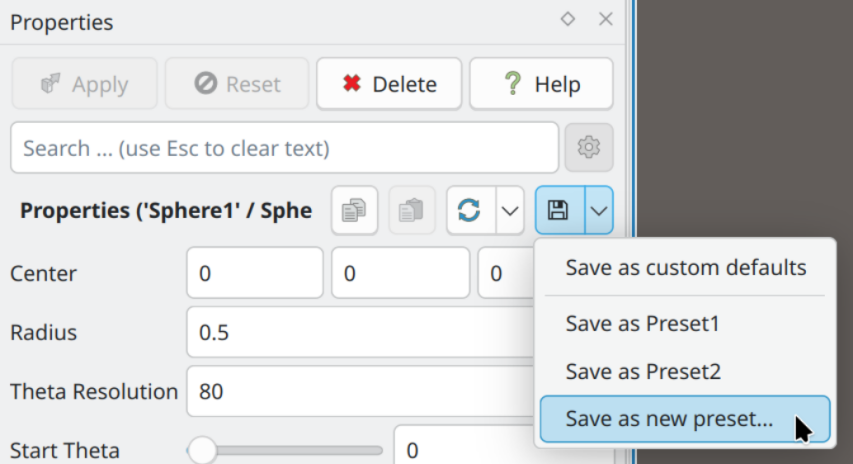
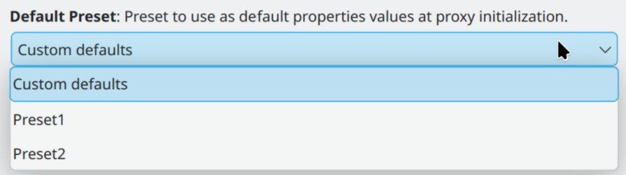
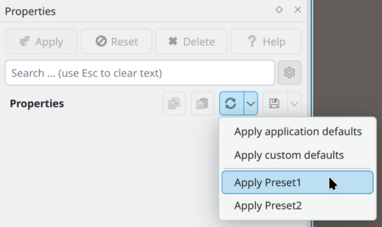

## Add settings presets

You can now save filters, display and view settings as a preset to be able to save it and restore it later.
Presets are saved and applied separately following the three settings groups: Properties, View and Display.
To save a preset, click on the arrow of the "Save current settings values as default" button and select an existing preset or create a new one.
To apply a preset, use the "Apply application defaults" button instead.

*Save preset menu*

A new setting in the general settings has been added to choose which preset to use as default settings at proxy initialization.

*Default preset setting*

## "Apply application defaults" button rework

New options have been added to the "Apply application defaults" button to apply custom defaults and presets.
These options can be accessed by clicking on the arrow on the right of the button.

*Apply preset menu*
