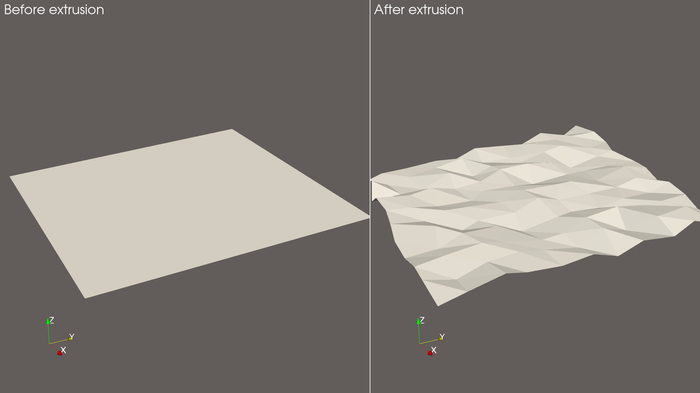

## Add support of vector 3 and normal recalculation in extrusion surface representation

The extrusion surface representation can now process vector 3 as input data. If such an input data array is selected, it will be treated as a displacement on the GPU (see image below).

An option to recalcuate the normals after the extrusion has also been added in order to prevent bad visual results due to flat surface (for example with a plane).

