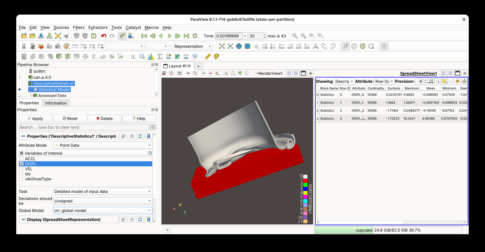
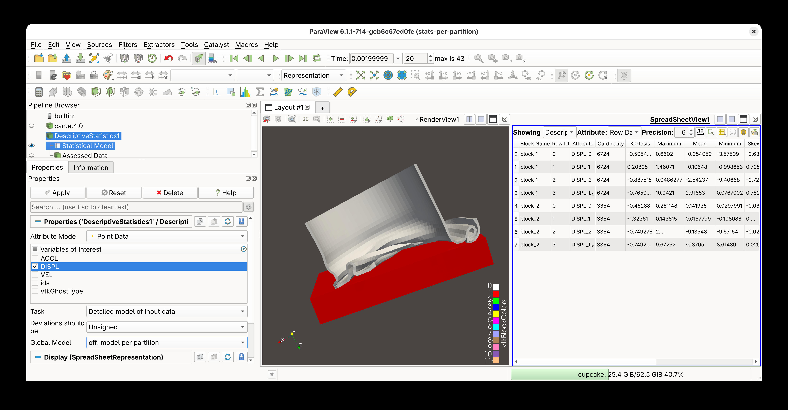

# Improved Descriptive Statistics

There are two major improvements to descriptive statistics:
1. For partitioned dataset collections, ParaView now supports generating either global
   statistical models (the previous behavior and current default) or per-assembly-node
   statistical models.
2. Instead of producing two tables (learned and derived statistics), a single
   table is produced—which is much easier to read in the spreadsheet view.
   This also takes into account distributed data (i.e., statistics will not be repeated
   once for each process when running parallel server processes).

> 
> 
>
> Now it is possible to have statistical models computed for each assembly-tree
> node in partitioned dataset collections.
