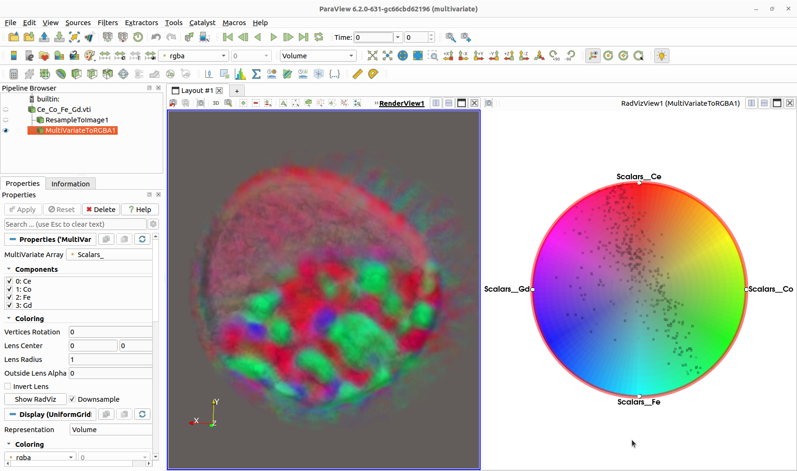

## Multivariate data coloring and RadViz view

ParaView now provides the **MultiVariate To RGBA** filter, which maps an array with 3 to 7 components to color and opacity, so that you can volume render multivariate data. The color of a point shows the relative values of its components and its opacity shows their average. The filter is based on the papers "RadVolViz: An Information Display-Inspired Transfer Function Editor for Multivariate Volume Visualization" and "RadViz Deluxe: An Attribute-Aware Display for Multivariate Data".

Select the array with **MultiVariate Array** and, under **Components**, uncheck the components that you do not want to use. **Vertices Rotation** and **Vertices Clockwise Ordering** place the components around a circle, and a lens defined by **Lens Center** and **Lens Radius** makes the points outside of it transparent, or the points inside of it with **Invert Lens**. In the advanced _Partitions_ editor, you can split the components into groups that are normalized separately, which helps when their ranges are very different, and rescale each group to its data range or to a custom range.

> 
>
> A battery dataset with four components (Ce, Co, Fe and Gd): a volume rendering colored by MultiVariate To RGBA (left) and its RadViz view (right).

Click _Show RadViz_ in the filter's properties to open the new **RadViz View**, which places each point inside a circle according to the relative values of its components, over a color wheel that shows the color computed for each position. With _Downsample_ checked, the view shows a resampled, smaller version of the filter's input. The view and the filter stay in sync: rotating the vertices or dragging and resizing the lens in the view updates the filter's properties and highlights _Apply_, and hiding or showing a component in the view's _Series Parameters_ updates the filter's **Components**. Changes to the filter's properties, except **Invert Lens**, appear in the view right away, before you click _Apply_, and _Reset_ restores them. You can edit the labels of the vertices in _Series Parameters_, and disconnect the view from the filter, or connect it again, from the view's context menu. The connection is kept in state files.

When **Map Scalars** is off and you color by a 2- or 4-component array, the opacity transfer function now covers the full range of valid opacities, so that a volume rendering uses the opacity stored in the last component.
