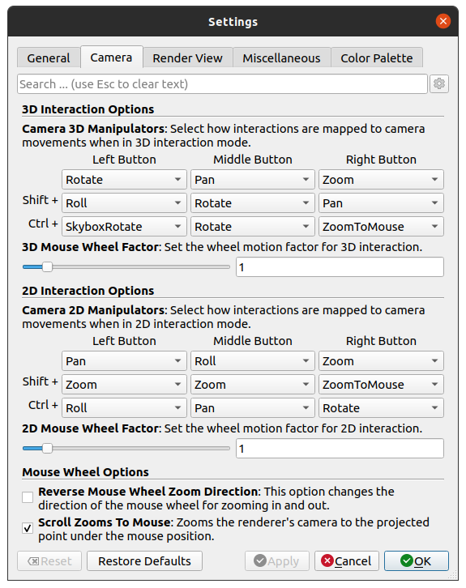

## Scroll Zooms To Mouse Position

You can now simply scroll the mouse wheel in order to zoom to the projected point
under the mouse position without holding down the Ctrl key.
All you need to do is enable the 'Scroll Zooms To Mouse' checkbox under Settings -> Camera.

